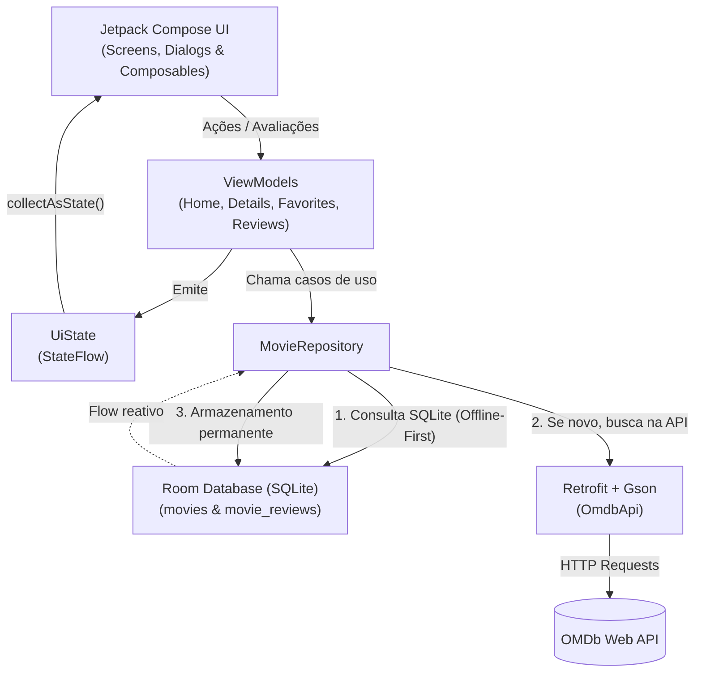

# 🎬 CineApp UERN - Aplicativo de Filmes

> **Projeto Avaliativo da Unidade 3**  
> **Disciplina:** 2026.2 - Programação e Design para Dispositivos Móveis  
> **Curso:** Sistemas para Internet  
> **Aluno:** Madson Gustavo Fagundes Pinto de Carvalho  
> **Instituição:** Universidade do Estado do Rio Grande do Norte (UERN)

Aplicativo Android moderno desenvolvido com **Kotlin** e **Jetpack Compose**, seguindo rigorosamente a arquitetura **MVVM (Model-View-ViewModel)**. O app consome a API RESTful da [OMDb (Open Movie Database)](https://www.omdbapi.com/) e implementa uma estratégia de persistência local com **Room (SQLite)** orientada a **Offline-First**, com **armazenamento progressivo permanente**, **sistema de avaliações com comentários (1 a 5 estrelas)** e suporte completo a **filmes favoritos offline**.

---

## 📌 Sumário

- [Identificação do Projeto](#-identificação-do-projeto)
- [Visão Geral](#-visão-geral)
- [Funcionalidades](#-funcionalidades)
- [Arquitetura e Fluxo de Dados](#-arquitetura-e-fluxo-de-dados)
- [Stack de Tecnologias](#-stack-de-tecnologias)
- [Estrutura do Projeto](#-estrutura-do-projeto)
- [Estratégia de Persistência Offline-First](#-estratégia-de-persistência-offline-first)
- [Como Configurar e Executar](#-como-configurar-e-executar)
- [Documentação Detalhada](#-documentação-detalhada)

---

## 🎓 Identificação do Projeto

- **Semestre Letivo:** 2026.2
- **Curso:** Sistemas para Internet
- **Componente Curricular:** Programação e Design para Dispositivos Móveis
- **Avaliação:** Projeto da Unidade 3
- **Desenvolvedor:** Madson Gustavo Fagundes Pinto de Carvalho

---

## 🚀 Visão Geral

Este projeto foi desenvolvido como requisito avaliativo da **Unidade 3** da disciplina de **Programação e Design para Dispositivos Móveis (2026.2 - Sistemas para Internet / UERN)**, unindo as ferramentas e boas práticas mais atuais do ecossistema Android:
- Interface 100% declarativa em **Jetpack Compose** com **Material Design 3** e estética cinematográfica de alto contraste.
- Gerenciamento reativo de estado com **StateFlow** e **Coroutines**.
- Persistência com **Room (SQLite)** sob a premissa **Offline-First**: conforme o usuário explora o app, títulos, detalhes, favoritos e avaliações são salvos permanentemente no SQLite.
- Comunicação de rede desacoplada com **Retrofit**, conversão com **Gson** e carregamento fluido de pôsteres com **Coil**.

---

## ✨ Funcionalidades

1. **Tela Inicial (Menu)**: Ponto central de navegação com acesso rápido para exploração do catálogo, filmes favoritos e avaliações do usuário.
2. **Explorar Catálogo & Top 10 IMDb**:
   - Exibe por padrão as 10 maiores obras-primas da história do cinema (IMDb Top 10) com badges douradas de colocação.
   - Pesquisa em tempo real de qualquer título pela API do OMDb com chips de sugestões rápidas.
3. **Detalhes do Filme (Offline-First)**:
   - Exibição de pôster em alta resolução, ano, gênero, nota IMDb e sinopse completa.
   - Os dados são armazenados de forma permanente no SQLite: se o filme já tiver sido aberto antes, ele carrega instantaneamente do banco local mesmo sem internet.
4. **Sistema de Avaliações e Comentários do Usuário (SQLite)**:
   - Botão **"Avaliar Filme"** na tela de detalhes que abre um **Modal interativo**.
   - O usuário pode atribuir de **1 a 5 estrelas** e redigir um comentário/resenha.
   - Os dados são gravados na tabela `movie_reviews` no SQLite local.
   - Exibição da avaliação do usuário nos detalhes com opção de edição ou exclusão.
5. **Tela "Minhas Avaliações"**:
   - Listagem dedicada de todos os filmes que o usuário avaliou, com estrelas, comentário e data/hora.
   - Acesso com um toque para abrir o filme correspondente ou remover a avaliação.
6. **Gerenciamento de Favoritos**:
   - Botão flutuante (FAB) e ícone animado com escalonamento suave para favoritar/desfavoritar.
   - Lista reativa de favoritos atualizada instantaneamente quando o status muda.
   - A sincronização com a API nunca sobrescreve o status de favorito marcado pelo usuário.

---

## 🏗 Arquitetura e Fluxo de Dados

O aplicativo segue o padrão recomendado pela Google de **Arquitetura em Camadas (MVVM + Repository Pattern)** com o **SQLite como Fonte Única da Verdade**:



---

## 🛠 Stack de Tecnologias

| Tecnologia | Versão | Propósito |
| :--- | :--- | :--- |
| **Kotlin** | `2.2.10` | Linguagem principal moderna e concisa |
| **Jetpack Compose** | BoM `2026.02.01` | Framework declarativo de interface de usuário |
| **Material 3** | Latest | Sistema de design moderno, tokens de cores e componentes |
| **Navigation Compose** | `2.8.5` | Roteamento desacoplado entre telas com transições suaves |
| **Room Database** | `2.7.0` | Camada de persistência SQLite com suporte a KSP e Kotlin |
| **KSP (Kotlin Symbol Processing)**| `2.2.10-2.0.2`| Processador de anotações veloz para o Room Compiler |
| **Retrofit** | `2.11.0` | Cliente HTTP type-safe para comunicação com a API |
| **Gson & Converter** | `2.11.0` | Serialização e desserialização de payloads JSON |
| **Coroutines & Flow** | `1.9.0` | Processamento assíncrono em segundo plano e fluxos reativos |
| **ViewModel & StateFlow** | `2.8.7` | Retenção de estado com sobrevivência a rotações e ciclo de vida |
| **Coil Compose** | `2.7.0` | Carregamento assíncrono de imagens/pôsteres com cache em memória |

---

## 📂 Estrutura do Projeto

```text
app/src/main/java/com/example/app_movies_unidade_3_uern/
├── MainActivity.kt                      # Activity principal e montagem do grafo de dependências
├── data/
│   ├── local/
│   │   ├── AppDatabase.kt               # Banco Room com tabelas 'movies' e 'movie_reviews'
│   │   ├── MovieDao.kt                  # DAO de filmes com Upsert atômico
│   │   ├── MovieEntity.kt               # Entidade persistente de filmes
│   │   ├── MovieReviewDao.kt            # DAO de avaliações e comentários do usuário
│   │   └── MovieReviewEntity.kt         # Entidade das avaliações (1 a 5 estrelas + texto)
│   ├── remote/
│   │   ├── NetworkModule.kt             # Cliente Retrofit e chave OMDb
│   │   ├── OmdbApi.kt                   # Endpoints HTTP da OMDb API
│   │   └── dto/
│   │       ├── MovieDetailsDto.kt       # DTO para endpoint ?i=
│   │       ├── MovieSearchResponse.kt   # DTO envelope para endpoint ?s=
│   │       └── MovieSummaryDto.kt       # DTO de item de filme na busca
│   └── repository/
│       └── MovieRepository.kt           # Orquestração Offline-First e gestão de avaliações
└── ui/
    ├── components/
    │   ├── AnimatedFavoriteButton.kt    # Botão de favoritar com animação de escala suave
    │   ├── EmptyStateView.kt            # Telas vazias amigáveis com botão de ação
    │   ├── ErrorStateView.kt            # Estado de erro centralizado com retry
    │   ├── MoviePosterView.kt           # Exibição de pôster com Coil, Shimmer e HTTPS
    │   ├── RatingReviewDialog.kt        # Modal de avaliação interativa (1 a 5 estrelas + comentário)
    │   ├── ShimmerModifier.kt           # Efeito Shimmer contínuo
    │   └── SkeletonComponents.kt        # Skeletons estruturais das telas
    ├── navigation/
    │   ├── AppNavHost.kt                # Declaração do NavHost e transição de rotas nativas
    │   └── Screen.kt                    # Definição das rotas tipadas (Home, MovieList, Details, Favorites, Reviews)
    ├── screens/
    │   ├── HomeScreen.kt                # Menu inicial com opções de navegação
    │   ├── MovieListScreen.kt           # Top 10 IMDb e busca com filtros rápidos
    │   ├── MovieDetailsScreen.kt        # Detalhes, nota, sinopse, avaliação e favorito
    │   ├── FavoritesScreen.kt           # Listagem reativa dos filmes favoritados
    │   └── ReviewsScreen.kt             # Listagem das avaliações e resenhas do usuário
    ├── state/
    │   └── UiState.kt                   # Sealed interface para estados de tela
    ├── theme/                           # Cores cinematográficas (Navy, Ruby, Amber), tipografia e tema
    └── viewmodel/
        ├── DetailsViewModel.kt          # ViewModel para detalhes, favoritos e avaliações
        ├── FavoritesViewModel.kt        # ViewModel para observação da lista de favoritos
        ├── HomeViewModel.kt             # ViewModel para busca e Top 10
        ├── ReviewsViewModel.kt          # ViewModel para listagem de avaliações
        └── ViewModelFactory.kt          # Factory para injeção manual das dependências
```

---

## 💾 Estratégia de Persistência Offline-First

### 1. Armazenamento Progressivo Permanente
No [`MovieRepository`](file:///C:/Users/Madson%20Gustavo/AndroidStudioProjects/appmoviesunidade3uern/app/src/main/java/com/example/app_movies_unidade_3_uern/data/repository/MovieRepository.kt), cada requisição de detalhes consulta primeiro o banco SQLite:
- Se o filme já estiver armazenado no banco local com sinopse completa, ele é entregue **imediatamente do SQLite**, sem necessidade de internet e sem prazos arbitrários de expiração.
- Caso o filme ainda não tenha sido consultado, a API OMDb é chamada, o registro é salvo no banco local e fica disponível permanentemente offline.

### 2. Avaliações no SQLite (Tabela `movie_reviews`)
As notas de 1 a 5 estrelas e comentários do usuário são gravados com chave primária vinculada ao `movieId`. Isso permite:
- Exibir a resenha do usuário na tela de detalhes do filme.
- Listar todas as avaliações na tela **Minhas Avaliações**, mesmo sem conexão com a internet.
- Edição ou exclusão atômica da avaliação.

### 3. Upsert que Preserva o Status de Favorito
Para evitar que novas sincronizações com a API sobrescrevam a escolha do usuário de marcar o filme como favorito, o [`MovieDao`](file:///C:/Users/Madson%20Gustavo/AndroidStudioProjects/appmoviesunidade3uern/app/src/main/java/com/example/app_movies_unidade_3_uern/data/local/MovieDao.kt) utiliza uma query SQLite com `ON CONFLICT DO UPDATE`:
```sql
INSERT INTO movies (id, title, year, genre, plot, rating, posterUrl, isFavorite, lastUpdatedTimestamp)
VALUES (:id, :title, :year, :genre, :plot, :rating, :posterUrl, :isFavorite, :lastUpdatedTimestamp)
ON CONFLICT(id) DO UPDATE SET
    title = excluded.title,
    year = excluded.year,
    genre = excluded.genre,
    plot = excluded.plot,
    rating = excluded.rating,
    posterUrl = excluded.posterUrl,
    lastUpdatedTimestamp = excluded.lastUpdatedTimestamp;
```

---

## 💻 Como Configurar e Executar

### Pré-requisitos
- **Android Studio** Ladybug (ou versão mais recente).
- **JDK 17** ou superior configurado.
- Dispositivo físico Android com depuração USB ou Emulador Android (API 24+).

### Passo a Passo

1. **Clonar o Repositório**:
   ```bash
   git clone <URL_DO_REPOSITORIO>
   cd appmoviesunidade3uern
   ```

2. **Chave da API OMDb**:
   O aplicativo já vem configurado com uma chave de testes funcional em [`NetworkModule.kt`](file:///C:/Users/Madson%20Gustavo/AndroidStudioProjects/appmoviesunidade3uern/app/src/main/java/com/example/app_movies_unidade_3_uern/data/remote/NetworkModule.kt):
   ```kotlin
   const val API_KEY = "4a3b711b"
   ```

3. **Compilar o Projeto via Linha de Comando**:
   ```powershell
   ./gradlew assembleDebug
   ```

4. **Executar**:
   Abra o projeto no Android Studio e clique em **Run 'app'** (`Shift + F10`) no seu emulador ou dispositivo conectado.

---

## 📚 Documentação Detalhada

Para conferir o aprofundamento técnico e as justificativas arquiteturais de cada decisão tomada no projeto, consulte a pasta [`docs/`](file:///C:/Users/Madson%20Gustavo/AndroidStudioProjects/appmoviesunidade3uern/docs):

- 🏛 **[Arquitetura e Fluxo MVVM](file:///C:/Users/Madson%20Gustavo/AndroidStudioProjects/appmoviesunidade3uern/docs/architecture.md)**: Papéis de cada camada, gestão de estado reativo, tratamento de ciclo de vida e Single Source of Truth (SSOT).
- 💾 **[Estratégia Offline-First e Persistência](file:///C:/Users/Madson%20Gustavo/AndroidStudioProjects/appmoviesunidade3uern/docs/caching_strategy.md)**: Detalhamento do armazenamento progressivo no SQLite, sistema de avaliações (`movie_reviews`) e queries atômicas.
- 📦 **[Bibliotecas e Integrações](file:///C:/Users/Madson%20Gustavo/AndroidStudioProjects/appmoviesunidade3uern/docs/libraries_and_integrations.md)**: Análise detalhada de cada biblioteca da stack (Jetpack Compose, Room, Retrofit, Gson, KSP, Coil, Coroutines).
