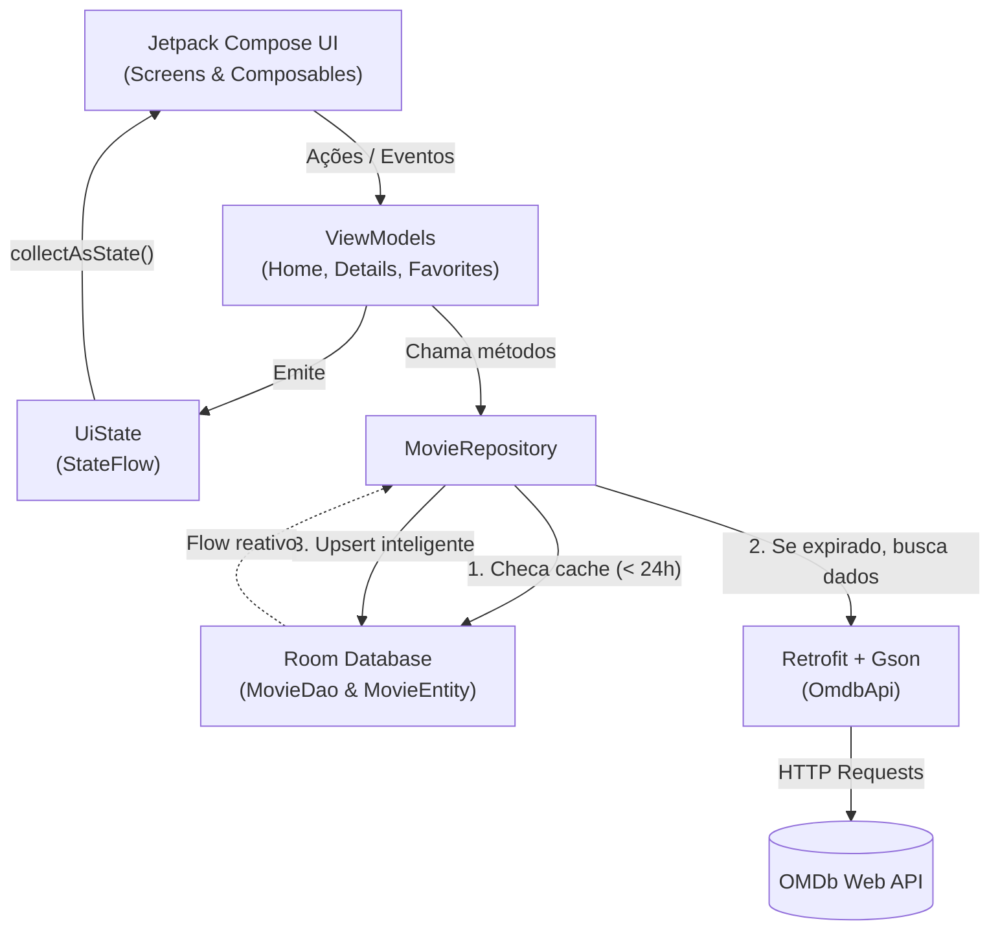

# 🎬 CineApp UERN - Aplicativo de Filmes

> **Projeto Avaliativo da Unidade 3**  
> **Disciplina:** 2026.2 - Programação e Design para Dispositivos Móveis  
> **Curso:** Sistemas para Internet  
> **Aluno:** Madson Gustavo Fagundes Pinto de Carvalho  
> **Instituição:** Universidade do Estado do Rio Grande do Norte (UERN)

Aplicativo Android moderno desenvolvido com **Kotlin** e **Jetpack Compose**, seguindo rigorosamente a arquitetura **MVVM (Model-View-ViewModel)**. O app consome a API RESTful da [OMDb (Open Movie Database)](https://www.omdbapi.com/) e implementa uma estratégia de persistência local com **Room (SQLite)** contendo **cache inteligente de 1 dia** e suporte a **filmes favoritos offline**.

---

## 📌 Sumário

- [Identificação do Projeto](#-identificação-do-projeto)
- [Visão Geral](#-visão-geral)
- [Funcionalidades](#-funcionalidades)
- [Arquitetura e Fluxo de Dados](#-arquitetura-e-fluxo-de-dados)
- [Stack de Tecnologias](#-stack-de-tecnologias)
- [Estrutura do Projeto](#-estrutura-do-projeto)
- [Estratégia de Cache e Persistência](#-estratégia-de-cache-e-persistência)
- [Como Configurar e Executar](#-como-configurar-e-executar)
- [Documentação Detalhada](#-documentação-detalhada)

---

## 🎓 Identificação do Projeto

- **Semestre Letivo:** 2026.2
- **Curso:** Sistemas para Internet
- **Componente Curricular:** Programação e Design para Dispositivos Móveis
- **Avaliação:** Projeto da Unidade 3
- **Desenvolvedor:** Madson Gustavo Fagundes Pinto de Carvalho

---

## 🚀 Visão Geral

Este projeto foi desenvolvido como requisito avaliativo da **Unidade 3** da disciplina de **Programação e Design para Dispositivos Móveis (2026.2 - Sistemas para Internet / UERN)**, unindo as ferramentas e boas práticas mais atuais do ecossistema Android:
- Interface 100% declarativa em **Jetpack Compose** com **Material Design 3**.
- Gerenciamento reativo de estado com **StateFlow** e **Coroutines**.
- Cache local inteligente com **Room**, atualizações via **KSP (Kotlin Symbol Processing)** e preservação de dados do usuário.
- Comunicação de rede desacoplada com **Retrofit** e conversão com **Gson**.

---

## ✨ Funcionalidades

1. **Tela Inicial (Menu)**: Ponto central de navegação com acesso rápido para exploração do catálogo e para os filmes favoritos.
2. **Explorar / Buscar Filmes**: Pesquisa em tempo real de títulos pela API do OMDb com paginação de dados básicos, pôsteres assíncronos e tratamento de erros.
3. **Detalhes do Filme com Cache de 1 Dia**:
   - Exibição de pôster em alta resolução, ano, gênero, nota IMDb e sinopse completa.
   - Verificação automática da validade do cache: se consultado há menos de 24 horas, o dado é carregado instantaneamente do banco Room sem requisição de rede.
   - Atualização transparente caso o cache esteja expirado.
   - Suporte a leitura offline caso não haja conexão à internet.
4. **Gerenciamento de Favoritos**:
   - Botão flutuante (FAB) e ícone no topo para favoritar/desfavoritar.
   - Lista reativa de favoritos atualizada instantaneamente quando o status muda.
   - A sincronização com a API nunca sobrescreve o status de favorito marcado pelo usuário.

---

## 🏗 Arquitetura e Fluxo de Dados

O aplicativo segue o padrão recomendado pela Google de **Arquitetura em Camadas (MVVM + Repository Pattern)**:



---

## 🛠 Stack de Tecnologias

| Tecnologia | Versão | Propósito |
| :--- | :--- | :--- |
| **Kotlin** | `2.2.10` | Linguagem principal moderna e concisa |
| **Jetpack Compose** | BoM `2026.02.01` | Framework declarativo de interface de usuário |
| **Material 3** | Latest | Sistema de design moderno, tokens de cores e componentes |
| **Navigation Compose** | `2.8.5` | Roteamento desacoplado entre telas com passagem de argumentos |
| **Room Database** | `2.7.0` | Camada de persistência SQLite com suporte a KSP e Kotlin |
| **KSP (Kotlin Symbol Processing)**| `2.2.10-2.0.2`| Processador de anotações veloz para o Room Compiler |
| **Retrofit** | `2.11.0` | Cliente HTTP type-safe para comunicação com a API |
| **Gson & Converter** | `2.11.0` | Serialização e desserialização de payloads JSON |
| **Coroutines & Flow** | `1.9.0` | Processamento assíncrono em segundo plano e fluxos reativos |
| **ViewModel & StateFlow** | `2.8.7` | Retenção de estado com sobrevivência a rotações e ciclo de vida |
| **Coil Compose** | `2.7.0` | Carregamento assíncrono de imagens/pôsteres com cache em memória |

---

## 📂 Estrutura do Projeto

```text
app/src/main/java/com/example/app_movies_unidade_3_uern/
├── MainActivity.kt                      # Activity principal e montagem do grafo de dependências
├── data/
│   ├── local/
│   │   ├── AppDatabase.kt               # Configuração do banco Room (Singleton)
│   │   ├── MovieDao.kt                  # Interface DAO com queries e Upsert customizado
│   │   └── MovieEntity.kt               # Tabela 'movies' com campos de cache e favorito
│   ├── remote/
│   │   ├── NetworkModule.kt             # Cliente Retrofit e chave OMDb
│   │   ├── OmdbApi.kt                   # Endpoints HTTP da OMDb API
│   │   └── dto/
│   │       ├── MovieDetailsDto.kt       # DTO para endpoint ?i=
│   │       ├── MovieSearchResponse.kt   # DTO envelope para endpoint ?s=
│   │       └── MovieSummaryDto.kt       # DTO de item de filme na busca
│   └── repository/
│       └── MovieRepository.kt           # Orquestração de cache de 24h e Single Source of Truth
└── ui/
    ├── navigation/
    │   ├── AppNavHost.kt                # Declaração do NavHost e transição de rotas
    │   └── Screen.kt                    # Definição das rotas tipadas
    ├── screens/
    │   ├── HomeScreen.kt                # Menu inicial com opções de navegação
    │   ├── MovieListScreen.kt           # Pesquisa e lista de filmes
    │   ├── MovieDetailsScreen.kt        # Detalhes, nota, sinopse e botão de favorito
    │   └── FavoritesScreen.kt           # Listagem reativa dos filmes favoritados
    ├── state/
    │   └── UiState.kt                   # Sealed interface para estados de tela (Loading, Success, Error, Idle)
    ├── theme/                           # Definições de tema, tipografia e cores
    └── viewmodel/
        ├── DetailsViewModel.kt          # ViewModel para detalhes do filme e favoritos
        ├── FavoritesViewModel.kt        # ViewModel para observação da lista de favoritos
        ├── HomeViewModel.kt             # ViewModel para busca de filmes
        └── ViewModelFactory.kt          # Factory para injeção manual das dependências
```

---

## 💾 Estratégia de Cache e Persistência

### 1. Regra de 1 Dia (24 Horas)
No [`MovieRepository`](file:///C:/Users/Madson%20Gustavo/AndroidStudioProjects/appmoviesunidade3uern/app/src/main/java/com/example/app_movies_unidade_3_uern/data/repository/MovieRepository.kt), cada requisição de detalhes consulta primeiro o banco Room:
- Se o filme existir no banco, tiver dados preenchidos (`plot` não vazio) e `(currentTime - lastUpdatedTimestamp) < 24h`, o retorno é **imediato do banco local**, sem gastar cota de rede.
- Caso contrário, a API OMDb é chamada, o registro é salvo com o timestamp atual e os dados são entregues à UI.

### 2. Upsert que Preserva o Status de Favorito
Para evitar que uma atualização de cache da API sobrescreva a escolha do usuário de marcar o filme como favorito, o [`MovieDao`](file:///C:/Users/Madson%20Gustavo/AndroidStudioProjects/appmoviesunidade3uern/app/src/main/java/com/example/app_movies_unidade_3_uern/data/local/MovieDao.kt) utiliza uma query SQLite com `ON CONFLICT DO UPDATE`:
```sql
INSERT INTO movies (id, title, year, genre, plot, rating, posterUrl, isFavorite, lastUpdatedTimestamp)
VALUES (:id, :title, :year, :genre, :plot, :rating, :posterUrl, :isFavorite, :lastUpdatedTimestamp)
ON CONFLICT(id) DO UPDATE SET
    title = excluded.title,
    year = excluded.year,
    genre = excluded.genre,
    plot = excluded.plot,
    rating = excluded.rating,
    posterUrl = excluded.posterUrl,
    lastUpdatedTimestamp = excluded.lastUpdatedTimestamp;
    -- Note que 'isFavorite' é omitido do DO UPDATE, garantindo integridade dos dados!
```

---

## 💻 Como Configurar e Executar

### Pré-requisitos
- **Android Studio** Ladybug (ou versão mais recente).
- **JDK 17** ou superior configurado.
- Dispositivo físico Android com depuração USB ou Emulador Android (API 24+).

### Passo a Passo

1. **Clonar o Repositório**:
   ```bash
   git clone <URL_DO_REPOSITORIO>
   cd appmoviesunidade3uern
   ```

2. **Chave da API OMDb**:
   O aplicativo já vem configurado com uma chave de testes funcional em [`NetworkModule.kt`](file:///C:/Users/Madson%20Gustavo/AndroidStudioProjects/appmoviesunidade3uern/app/src/main/java/com/example/app_movies_unidade_3_uern/data/remote/NetworkModule.kt):
   ```kotlin
   const val API_KEY = "4a3b711b"
   ```
   Caso queira utilizar sua chave própria e gratuita, solicite em [omdbapi.com/apikey.aspx](https://www.omdbapi.com/apikey.aspx) e substitua a constante.

3. **Compilar o Projeto via Linha de Comando**:
   ```powershell
   ./gradlew assembleDebug
   ```

4. **Executar**:
   Abra o projeto no Android Studio e clique em **Run 'app'** (`Shift + F10`) no seu emulador ou dispositivo conectado.

---

## 📚 Documentação Detalhada

Para conferir o aprofundamento técnico e as justificativas arquiteturais de cada decisão tomada no projeto, consulte a pasta [`docs/`](file:///C:/Users/Madson%20Gustavo/AndroidStudioProjects/appmoviesunidade3uern/docs):

- 🏛 **[Arquitetura e Fluxo MVVM](file:///C:/Users/Madson%20Gustavo/AndroidStudioProjects/appmoviesunidade3uern/docs/architecture.md)**: Papéis de cada camada, gestão de estado reativo, tratamento de ciclo de vida e Single Source of Truth (SSOT).
- 💾 **[Estratégia de Cache e Persistência](file:///C:/Users/Madson%20Gustavo/AndroidStudioProjects/appmoviesunidade3uern/docs/caching_strategy.md)**: Detalhamento do mecanismo de expiração de 24 horas, query de Upsert sem perda de estado e fallback offline.
- 📦 **[Bibliotecas e Integrações](file:///C:/Users/Madson%20Gustavo/AndroidStudioProjects/appmoviesunidade3uern/docs/libraries_and_integrations.md)**: Análise detalhada de cada biblioteca da stack (Jetpack Compose, Room, Retrofit, Gson, KSP, Coil, Coroutines), com razões técnicas da escolha de cada versão.
