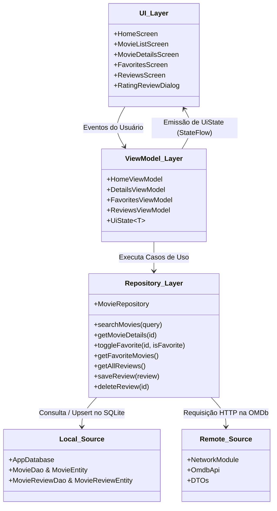
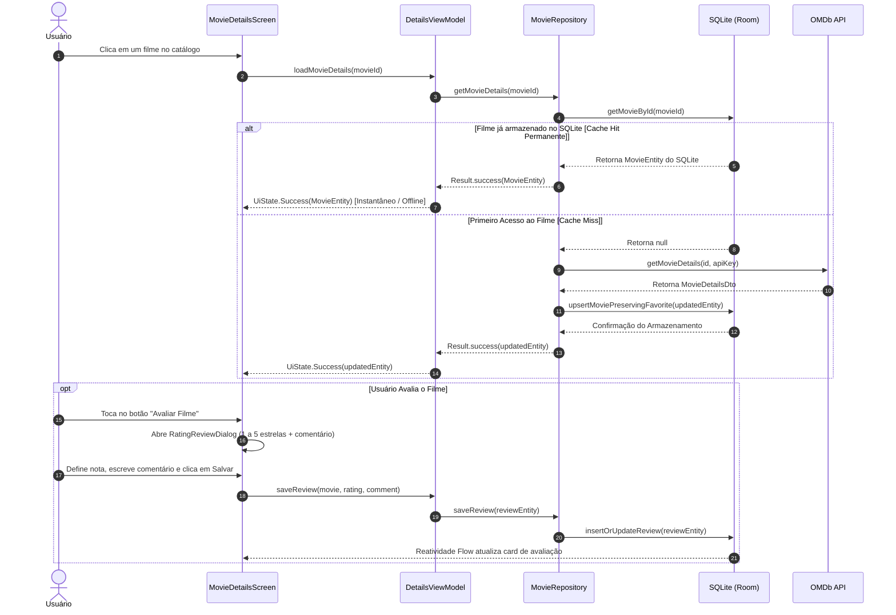

# 🏛 Arquitetura e Decisões de Design

> **Projeto Avaliativo da Unidade 3**  
> **Disciplina:** 2026.2 - Programação e Design para Dispositivos Móveis  
> **Curso:** Sistemas para Internet (UERN)  
> **Aluno:** Madson Gustavo Fagundes Pinto de Carvalho  

Este documento detalha as decisões arquiteturais adotadas no desenvolvimento do **CineApp UERN**, fundamentadas nas diretrizes oficiais da Google para arquitetura moderna no Android (*Guide to app architecture*) e no paradigma **Offline-First**.

---

## 1. Princípios Arquiteturais Adotados

1. **Separação de Preocupações (Separation of Concerns)**:
   - A interface de usuário (UI) não conhece o SQLite nem o Retrofit; ela apenas observa estados (`UiState`) e dispara eventos de usuário.
   - O Repositório orquestra o fluxo de dados e isola a lógica de persistência e de rede.
   - Os DAOs (`MovieDao` e `MovieReviewDao`) gerenciam estritamente as operações no banco SQLite.
2. **Modelo Dirigido por Interface Reativa (Unidirectional Data Flow - UDF)**:
   - O fluxo de dados segue uma direção única:
     - Eventos (ex: clique, digitação, avaliação) sobem da UI para a ViewModel.
     - O estado atualizado desce da ViewModel para a UI na forma de `StateFlow`.
3. **Fonte Única da Verdade (Single Source of Truth - SSOT) & Offline-First**:
   - O banco local **Room (SQLite)** atua como a fonte primária de verdade. Conforme o usuário utiliza o app, o SQLite armazena permanentemente os filmes, detalhes, favoritos e avaliações, permitindo que o app funcione plenamente offline.

---

## 2. Diagrama de Camadas



---

## 3. Detalhamento de Cada Camada

### 3.1. Camada de Apresentação (UI Layer)
Construída 100% com **Jetpack Compose** e **Material 3**:
- **Stateless Composables**: As funções de tela recebem o estado e repassam eventos através de lambdas (ex: `onMovieClick: (String) -> Unit`), facilitando testes unitários e de pré-visualização.
- **Sealed Interface `UiState<T>`**:
  Padroniza a resposta assíncrona para qualquer tela em 4 estados determinísticos:
  ```kotlin
  sealed interface UiState<out T> {
      data object Idle : UiState<Nothing>
      data object Loading : UiState<Nothing>
      data class Success<out T>(val data: T) : UiState<T>
      data class Error(val message: String) : UiState<Nothing>
  }
  ```
- **Navegação com Navigation Compose**:
  O [`AppNavHost`](file:///C:/Users/Madson%20Gustavo/AndroidStudioProjects/appmoviesunidade3uern/app/src/main/java/com/example/app_movies_unidade_3_uern/ui/navigation/AppNavHost.kt) centraliza as rotas em um grafo desacoplado com transições suaves nativas (`slideIntoContainer` e `slideOutOfContainer`).

---

### 3.2. Camada de Estado (ViewModel Layer)
- As ViewModels herdam de `androidx.lifecycle.ViewModel` e sobrevivem a mudanças de configuração.
- **Coroutines com `viewModelScope`**: Todas as chamadas assíncronas são disparadas no escopo do ciclo de vida da ViewModel.
- **Exposição segura via `StateFlow`**: Estado mutável encapsulado privadamente e exposto como fluxo imutável para a UI.

---

### 3.3. Injeção de Dependências com `ViewModelFactory`
Implementação de [`ViewModelProvider.Factory`](file:///C:/Users/Madson%20Gustavo/AndroidStudioProjects/appmoviesunidade3uern/app/src/main/java/com/example/app_movies_unidade_3_uern/ui/viewmodel/ViewModelFactory.kt) para injetar o [`MovieRepository`](file:///C:/Users/Madson%20Gustavo/AndroidStudioProjects/appmoviesunidade3uern/app/src/main/java/com/example/app_movies_unidade_3_uern/data/repository/MovieRepository.kt) em:
- `HomeViewModel`
- `DetailsViewModel`
- `FavoritesViewModel`
- `ReviewsViewModel`

---

### 3.4. Camada de Repositório e Persistência
O [`MovieRepository`](file:///C:/Users/Madson%20Gustavo/AndroidStudioProjects/appmoviesunidade3uern/app/src/main/java/com/example/app_movies_unidade_3_uern/data/repository/MovieRepository.kt) orquestra a comunicação entre rede e banco local:
- Execução isolada em `Dispatchers.IO`.
- **Estratégia Offline-First**: Quando os dados de um filme já estão no SQLite, eles são servidos permanentemente sem expiração forçada.
- **Gestão de Avaliações**: Persistência de notas (1 a 5 estrelas) e comentários em tabela própria (`movie_reviews`).

---

## 4. Diagrama de Sequência: Consulta Offline-First e Avaliação


