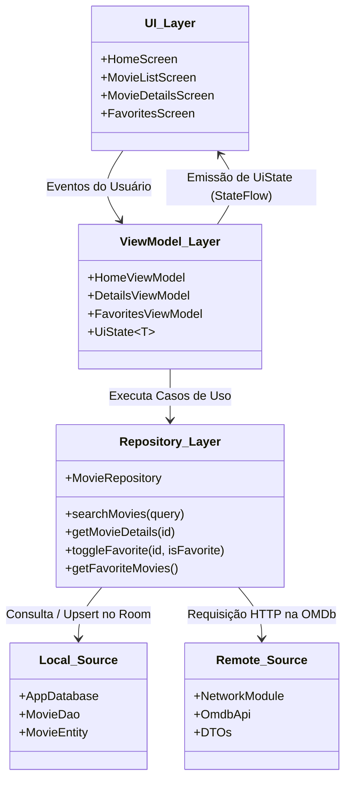
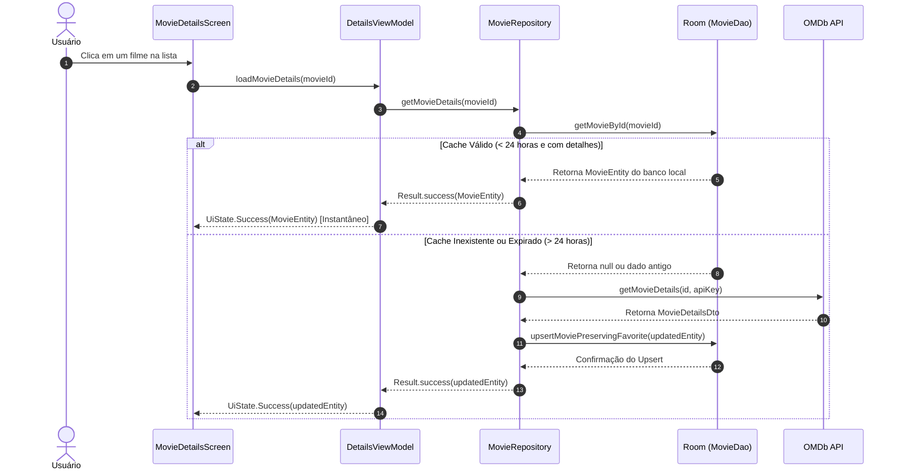

# 🏛 Arquitetura e Decisões de Design

> **Projeto Avaliativo da Unidade 3**  
> **Disciplina:** 2026.2 - Programação e Design para Dispositivos Móveis  
> **Curso:** Sistemas para Internet (UERN)  
> **Aluno:** Madson Gustavo Fagundes Pinto de Carvalho  

Este documento detalha as decisões arquiteturais adotadas no desenvolvimento do **CineApp UERN**, fundamentadas nas diretrizes oficiais da Google para arquitetura moderna no Android (*Guide to app architecture*).

---

## 1. Princípios Arquiteturais Adotados

1. **Separação de Preocupações (Separation of Concerns)**:
   - A interface de usuário (UI) não conhece o SQLite nem o Retrofit; ela apenas observa estados (`UiState`) e dispara eventos de usuário.
   - O Repositório orquestra o fluxo de dados e isola a lógica de cache e de rede.
   - O DAO (`MovieDao`) gerencia estritamente as operações no banco SQLite.
2. **Modelo Dirigido por Interface Reativa (Unidirectional Data Flow - UDF)**:
   - O fluxo de dados segue uma direção única:
     - Eventos (ex: clique, digitação) sobem da UI para a ViewModel.
     - O estado atualizado desce da ViewModel para a UI na forma de `StateFlow`.
3. **Fonte Única da Verdade (Single Source of Truth - SSOT)**:
   - Para os dados persistentes (detalhes e favoritos), o banco local **Room** atua como a fonte primária de verdade. Toda informação de detalhes passa ou é sincronizada com o banco local antes de ser exibida, garantindo consistência e suporte offline.

---

## 2. Diagrama de Camadas



---

## 3. Detalhamento de Cada Camada

### 3.1. Camada de Apresentação (UI Layer)
Construída 100% com **Jetpack Compose** e **Material 3**:
- **Stateless Composables**: As funções de tela recebem o estado e repassam eventos através de lambdas (ex: `onMovieClick: (String) -> Unit`), facilitando testes unitários e de pré-visualização.
- **Sealed Interface `UiState<T>`**:
  Padroniza a resposta assíncrona para qualquer tela em 4 estados determinísticos:
  ```kotlin
  sealed interface UiState<out T> {
      data object Idle : UiState<Nothing>
      data object Loading : UiState<Nothing>
      data class Success<out T>(val data: T) : UiState<T>
      data class Error(val message: String) : UiState<Nothing>
  }
  ```
- **Navegação com Navigation Compose**:
  O [`AppNavHost`](file:///C:/Users/Madson%20Gustavo/AndroidStudioProjects/appmoviesunidade3uern/app/src/main/java/com/example/app_movies_unidade_3_uern/ui/navigation/AppNavHost.kt) centraliza as rotas em um grafo desacoplado. Parâmetros dinâmicos (como `{movieId}`) são tipados como `NavType.StringType` e passados de forma limpa entre as telas.

---

### 3.2. Camada de Estado (ViewModel Layer)
- As ViewModels herdam de `androidx.lifecycle.ViewModel` e sobrevivem a mudanças de configuração (ex: rotação de tela).
- **Coroutines com `viewModelScope`**:
  Todas as chamadas assíncronas são disparadas no escopo do ciclo de vida da ViewModel, cancelando automaticamente requisições se a tela for destruída.
- **Exposição segura via `StateFlow`**:
  O estado interno mutável (`_moviesState: MutableStateFlow`) é mantido estritamente privado, expondo publicamente apenas uma versão de leitura imutável (`moviesState: StateFlow`), prevenindo mutações acidentais pela camada de visualização.

```kotlin
// Exemplo no HomeViewModel
private val _moviesState = MutableStateFlow<UiState<List<MovieSummaryDto>>>(UiState.Idle)
val moviesState: StateFlow<UiState<List<MovieSummaryDto>>> = _moviesState.asStateFlow()
```

---

### 3.3. Injeção de Dependências Manual com `ViewModelFactory`
Para manter o projeto enxuto, sem necessidade de ferramentas de injeção pesadas como Hilt ou Dagger, utilizamos uma implementação limpa de [`ViewModelProvider.Factory`](file:///C:/Users/Madson%20Gustavo/AndroidStudioProjects/appmoviesunidade3uern/app/src/main/java/com/example/app_movies_unidade_3_uern/ui/viewmodel/ViewModelFactory.kt):
- Permite que as ViewModels recebam a instância de [`MovieRepository`](file:///C:/Users/Madson%20Gustavo/AndroidStudioProjects/appmoviesunidade3uern/app/src/main/java/com/example/app_movies_unidade_3_uern/data/repository/MovieRepository.kt) em seus construtores.
- Garante total testabilidade, permitindo passar um repositório mockado em testes automatizados.

---

### 3.4. Camada de Repositório (Data Layer)
O [`MovieRepository`](file:///C:/Users/Madson%20Gustavo/AndroidStudioProjects/appmoviesunidade3uern/app/src/main/java/com/example/app_movies_unidade_3_uern/data/repository/MovieRepository.kt) funciona como o mediador central entre a API OMDb e o banco de dados Room:
- Troca de contexto explícita para `Dispatchers.IO` através de `withContext(Dispatchers.IO)`, garantindo que operações de I/O em disco ou na rede jamais bloqueiem a thread principal de renderização (*Main Thread*).
- Retorno encapsulado com `kotlin.Result` para tratamento transparente de sucessos e falhas.

---

## 4. Diagrama de Sequência: Consulta com Cache de 24 Horas


