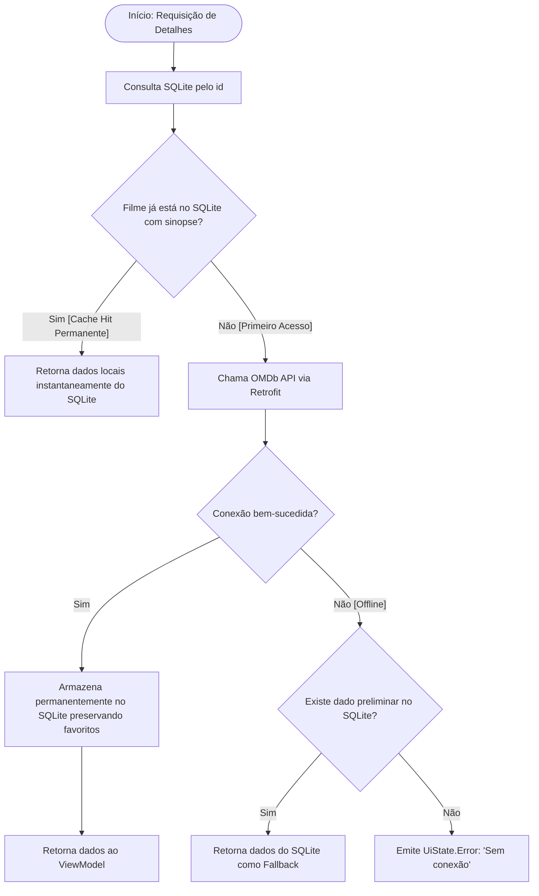

# 💾 Arquitetura Offline-First e Persistência Local (SQLite / Room)

Este documento descreve detalhadamente o funcionamento da camada de persistência com o **Room (SQLite)**, a premissa de arquitetura **Offline-First Progressiva** e a gestão das avaliações do usuário (*1 a 5 estrelas e comentários*).

---

## 1. O Paradigma Offline-First

Diferente de modelos de cache efêmeros ou transitórios (como prazos de 24 horas), o **CineApp UERN** adota uma filosofia **Offline-First**:
1. **O SQLite (Room) é a Fonte Única da Verdade (Single Source of Truth)**.
2. **Armazenamento Progressivo**: Conforme o usuário utiliza o aplicativo, pesquisa títulos, visualiza detalhes e marca favoritos, o banco de dados SQLite vai progressivamente acumulando e salvando esses dados de forma **permanente**.
3. **Acesso Offline Imediato**: Se o filme já tiver sido visualizado ou salvo anteriormente, seus dados (sinopse, ano, nota, avaliações) são carregados instantaneamente do SQLite local, sem depender de conexão com a internet.
4. **Resiliência e Continuidade**: O usuário pode continuar explorando os filmes já visitados, gerenciando favoritos e consultando suas próprias avaliações mesmo em modo avião ou sem conectividade.

---

## 2. Tabelas do Banco de Dados ([`AppDatabase`](file:///C:/Users/Madson%20Gustavo/AndroidStudioProjects/appmoviesunidade3uern/app/src/main/java/com/example/app_movies_unidade_3_uern/data/local/AppDatabase.kt))

O banco de dados SQLite é versionado e gerencia duas entidades principais:

```
┌───────────────────────────────────────┐       ┌───────────────────────────────────────┐
│                movies                 │       │             movie_reviews             │
├───────────────────────────────────────┤       ├───────────────────────────────────────┤
│ id (PK, String)                       │       │ movieId (PK, String)                  │
│ title (String)                        │       │ movieTitle (String)                   │
│ year (String)                         │       │ moviePosterUrl (String)               │
│ genre (String)                        │       │ movieYear (String)                    │
│ plot (String)                         │       │ rating (Int: 1 a 5 estrelas)          │
│ rating (String, IMDb)                 │       │ comment (String)                      │
│ posterUrl (String)                    │       │ timestamp (Long)                      │
│ isFavorite (Boolean)                  │       └───────────────────────────────────────┘
│ lastUpdatedTimestamp (Long)           │
└───────────────────────────────────────┘
```

---

## 3. Entidade de Filmes ([`MovieEntity`](file:///C:/Users/Madson%20Gustavo/AndroidStudioProjects/appmoviesunidade3uern/app/src/main/java/com/example/app_movies_unidade_3_uern/data/local/MovieEntity.kt))

```kotlin
@Entity(tableName = "movies")
data class MovieEntity(
    @PrimaryKey
    val id: String,                         // imdbID único (ex: "tt0111161")
    val title: String,                      // Título do filme
    val year: String,                       // Ano de lançamento
    val genre: String,                      // Gêneros (ex: "Action, Crime, Drama")
    val plot: String,                       // Sinopse completa
    val rating: String,                     // Nota no IMDb (ex: "9.3")
    val posterUrl: String,                  // URL do pôster (normalizada para HTTPS)
    val isFavorite: Boolean = false,        // Flag de favorito controlada pelo usuário
    val lastUpdatedTimestamp: Long = System.currentTimeMillis()
)
```

### Upsert Inteligente via SQLite
Ao sincronizar dados da OMDb API com o banco local, a query customizada no [`MovieDao`](file:///C:/Users/Madson%20Gustavo/AndroidStudioProjects/appmoviesunidade3uern/app/src/main/java/com/example/app_movies_unidade_3_uern/data/local/MovieDao.kt) utiliza a cláusula atômica `ON CONFLICT(id) DO UPDATE SET`:
```sql
INSERT INTO movies (
    id, title, year, genre, plot, rating, posterUrl, isFavorite, lastUpdatedTimestamp
)
VALUES (
    :id, :title, :year, :genre, :plot, :rating, :posterUrl, :isFavorite, :lastUpdatedTimestamp
)
ON CONFLICT(id) DO UPDATE SET
    title = excluded.title,
    year = excluded.year,
    genre = excluded.genre,
    plot = excluded.plot,
    rating = excluded.rating,
    posterUrl = excluded.posterUrl,
    lastUpdatedTimestamp = excluded.lastUpdatedTimestamp;
```
Essa estratégia preserva intacto o status de `isFavorite` mesmo quando novos dados chegam da API externa.

---

## 4. Entidade de Avaliações ([`MovieReviewEntity`](file:///C:/Users/Madson%20Gustavo/AndroidStudioProjects/appmoviesunidade3uern/app/src/main/java/com/example/app_movies_unidade_3_uern/data/local/MovieReviewEntity.kt))

Permite que o usuário registre sua nota pessoal e escreva comentários sobre qualquer filme:

```kotlin
@Entity(tableName = "movie_reviews")
data class MovieReviewEntity(
    @PrimaryKey
    val movieId: String,             // ID único no IMDb
    val movieTitle: String,          // Título do filme
    val moviePosterUrl: String,      // Pôster em cache
    val movieYear: String,           // Ano de lançamento
    val rating: Int,                 // Avaliação do usuário (1 a 5 estrelas)
    val comment: String,             // Comentário ou resenha escrita
    val timestamp: Long = System.currentTimeMillis() // Momento da avaliação
)
```

### Operações no [`MovieReviewDao`](file:///C:/Users/Madson%20Gustavo/AndroidStudioProjects/appmoviesunidade3uern/app/src/main/java/com/example/app_movies_unidade_3_uern/data/local/MovieReviewDao.kt):
- `getAllReviews()`: Emite um `Flow<List<MovieReviewEntity>>` ordenado cronologicamente para alimentar a tela **Minhas Avaliações**.
- `getReviewByMovieId(movieId)`: Emite a avaliação específica para a tela de **Detalhes**.
- `insertOrUpdateReview(review)`: Insere ou atualiza atomicamente com `OnConflictStrategy.REPLACE`.
- `deleteReview(movieId)`: Permite que o usuário remova sua avaliação a qualquer momento.

---

## 5. Fluxo de Tomada de Decisão Offline-First



---

## 6. Reatividade em Tempo Real com `Flow`

Tanto os **Favoritos** quanto as **Avaliações** utilizam fluxos reativos do Room:
- Qualquer inserção, atualização ou exclusão (`insertOrUpdateReview`, `deleteReview`, `updateFavoriteStatus`) notifica automaticamente os ViewModels (`FavoritesViewModel`, `ReviewsViewModel`, `DetailsViewModel`).
- A interface Jetpack Compose é recomposta de forma fluida e instantânea sem necessidade de recarregar a tela manualmente.
