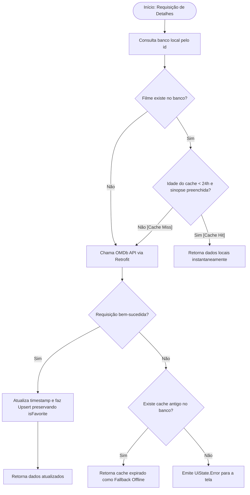

# 💾 Estratégia de Cache e Persistência Local

Este documento descreve detalhadamente o funcionamento da camada de persistência com o **Room**, a política de cache de 24 horas e a resolução técnica do desafio de integridade entre dados remotos e dados do usuário (*Favoritos*).

---

## 1. O Desafio Arquitetural

No aplicativo, precisávamos atender a dois requisitos simultâneos com uma **única tabela**:
1. **Cache de 1 dia para detalhes**: Reduzir chamadas desnecessárias à API e viabilizar leitura rápida/offline.
2. **Favoritos do usuário**: Permitir que o usuário marque filmes como favoritos para acesso permanente.

### O Problema do `@Upsert` ou `OnConflictStrategy.REPLACE`
Ao buscar dados atualizados da API OMDb, recebemos um JSON contendo os metadados do filme, porém a API não sabe nada sobre os favoritos locais do usuário.
- Se usássemos um `@Upsert` padrão do Room ou `@Insert(onConflict = OnConflictStrategy.REPLACE)`, a linha inteira seria substituída, **apagando o status de `isFavorite`** e revertendo-o para `false`.

---

## 2. A Solução: Upsert Inteligente via SQLite

Para solucionar esse problema no nível do banco de dados com máxima performance, foi criada uma query customizada no [`MovieDao`](file:///C:/Users/Madson%20Gustavo/AndroidStudioProjects/appmoviesunidade3uern/app/src/main/java/com/example/app_movies_unidade_3_uern/data/local/MovieDao.kt) utilizando a cláusula `ON CONFLICT(id) DO UPDATE SET`:

```sql
INSERT INTO movies (
    id, title, year, genre, plot, rating, posterUrl, isFavorite, lastUpdatedTimestamp
)
VALUES (
    :id, :title, :year, :genre, :plot, :rating, :posterUrl, :isFavorite, :lastUpdatedTimestamp
)
ON CONFLICT(id) DO UPDATE SET
    title = excluded.title,
    year = excluded.year,
    genre = excluded.genre,
    plot = excluded.plot,
    rating = excluded.rating,
    posterUrl = excluded.posterUrl,
    lastUpdatedTimestamp = excluded.lastUpdatedTimestamp;
```

### Por que essa query é eficiente?
- **Execução atômica no SQLite**: Ocorre em uma única operação interna de banco, sem necessidade de múltiplas leituras e escritas lentas.
- **Isolamento da coluna `isFavorite`**: Como a coluna `isFavorite` foi intencionalmente deixada de fora do bloco `DO UPDATE SET`, o SQLite preserva rigorosamente o valor que já estava gravado no banco para aquele filme caso ele já exista.
- **Inserção limpa para novos registros**: Se o filme for novo, ele é inserido com o `isFavorite = false` inicial padrão.

---

## 3. Modelo da Entidade ([`MovieEntity`](file:///C:/Users/Madson%20Gustavo/AndroidStudioProjects/appmoviesunidade3uern/app/src/main/java/com/example/app_movies_unidade_3_uern/data/local/MovieEntity.kt))

```kotlin
@Entity(tableName = "movies")
data class MovieEntity(
    @PrimaryKey
    val id: String,                         // imdbID único (ex: "tt0372784")
    val title: String,                      // Título do filme
    val year: String,                       // Ano de lançamento
    val genre: String,                      // Gêneros (ex: "Action, Crime, Drama")
    val plot: String,                       // Sinopse completa
    val rating: String,                     // Nota no IMDb (ex: "8.2")
    val posterUrl: String,                  // URL da imagem no CDN da Amazon
    val isFavorite: Boolean = false,        // Flag controlada pelo usuário
    val lastUpdatedTimestamp: Long = System.currentTimeMillis() // Momento do último cache
)
```

---

## 4. Política do Cache de 24 Horas (1 Dia)

Implementada no método `getMovieDetails(id)` do [`MovieRepository`](file:///C:/Users/Madson%20Gustavo/AndroidStudioProjects/appmoviesunidade3uern/app/src/main/java/com/example/app_movies_unidade_3_uern/data/repository/MovieRepository.kt):

```kotlin
val ONE_DAY_MILLIS = 24 * 60 * 60 * 1000L // 86.400.000 ms

val cachedMovie = movieDao.getMovieById(id)
val currentTime = System.currentTimeMillis()

val isCacheValid = cachedMovie != null &&
        cachedMovie.plot.isNotBlank() &&
        (currentTime - cachedMovie.lastUpdatedTimestamp) < ONE_DAY_MILLIS
```

### Critérios de Validação:
1. **Existência**: O filme precisa existir no banco local.
2. **Completude dos dados**: O campo `plot` (sinopse) deve estar preenchido (para garantir que não se trata apenas de um resumo vindo da listagem).
3. **Janela temporal**: A diferença entre o timestamp atual do sistema e o `lastUpdatedTimestamp` deve ser estritamente inferior a 24 horas (`86.400.000 ms`).

### Fluxo de Tomada de Decisão:


---

## 5. Resiliência Offline (Graceful Degradation)

Um padrão sênior implementado no repositório é o **fallback gracioso**:
Caso o usuário tente abrir os detalhes de um filme com mais de 24 horas de cache, mas esteja em um túnel, sem sinal ou com modo avião ativado:
1. A chamada Retrofit falha lançando uma exceção de rede (`IOException`).
2. O repositório captura a falha e verifica se há qualquer versão anterior salva no SQLite.
3. Se houver, ele retorna essa versão em vez de mostrar uma tela de erro em branco, garantindo que o usuário nunca fique desamparado.

---

## 6. Reatividade Automática com `Flow`

Para os filmes favoritos, o método no DAO retorna um fluxo reativo:
```kotlin
@Query("SELECT * FROM movies WHERE isFavorite = 1 ORDER BY title ASC")
fun getFavoriteMovies(): Flow<List<MovieEntity>>
```
- O Room monitora a tabela `movies` em segundo plano.
- Sempre que qualquer registro for alterado (por exemplo, quando o usuário clica no coração na tela de detalhes), o Room emite automaticamente a lista atualizada de favoritos para o `FavoritesViewModel`.
- A tela de favoritos é recomposta imediatamente, sem requisições manuais de recarga.
